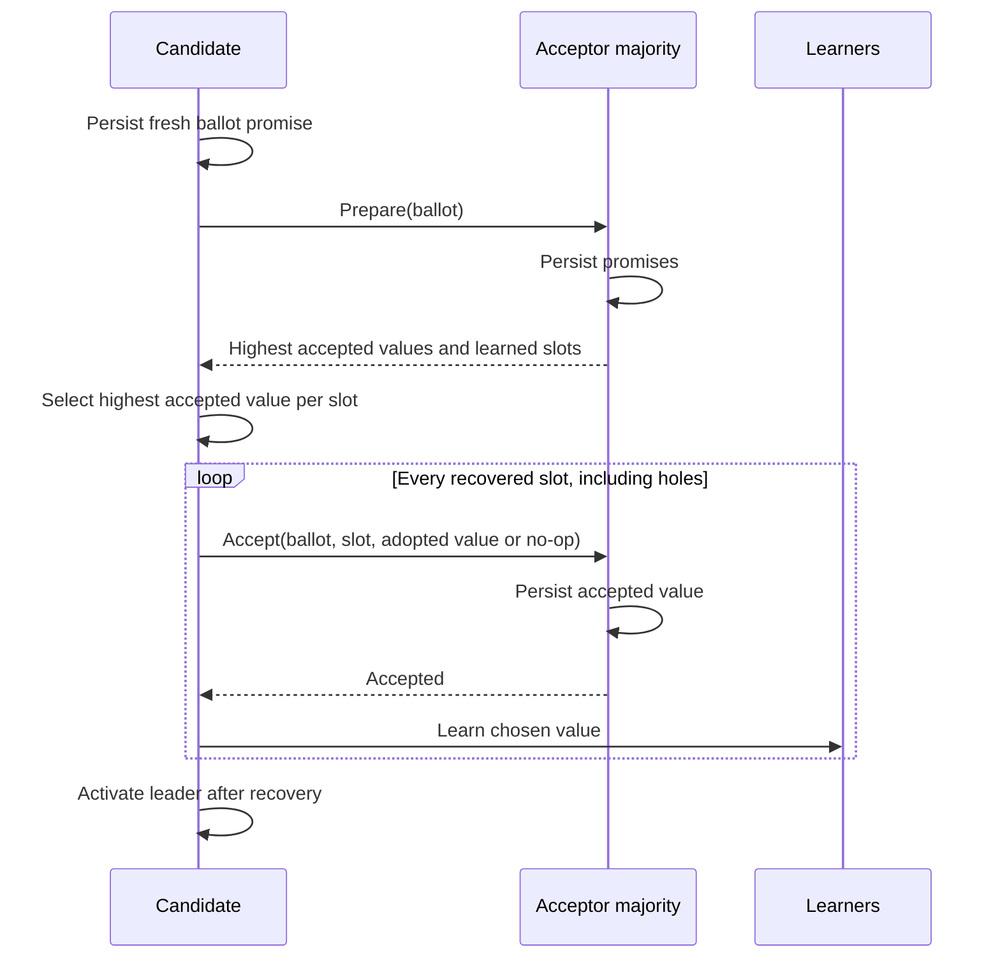

# PaxosVault — Protocol and Accounting Design

## Model

Each fixed member is simultaneously a proposer, acceptor, and learner. Transport is HTTP/JSON. Members may stop, restart from their WAL, lose messages, and be isolated. A shared token gates internal RPCs. Members are trusted to follow the protocol; the token is not a substitute for a Byzantine consensus protocol.

For `N = 2f + 1`, the decision quorum is `f + 1`. No membership changes take place while data is retained. The durable identity fingerprints the member ID, configured addresses, cluster ID, genesis supply, and protocol version, so accidental reuse under another configuration fails at startup.

## State and locking

| State | Persistence | Purpose |
| --- | --- | --- |
| Highest promised ballot | WAL, before response | Reject messages from earlier leaders |
| Highest accepted ballot/value for each slot | WAL, before response | Preserve possible prior decisions during election |
| Learned decisions | WAL, before application | Replay deterministic banking state after restart |
| Balances, receipts, audit events | Reconstructed from learned decisions | Avoid separate transactional state stores |
| Leader belief, election timer, observed higher ballots | Memory | Coordinate progress; never authorize a decision by themselves |

`proposeMu` serializes elections, submissions, read barriers, and leader pulses. `mu` protects acceptor state, the WAL, and the state machine. Acceptors remain available to remote higher ballots while the local proposer waits for a quorum. No network calls are made while holding `mu`.

## Election and recovery

Ballots compare `(round, member ID)` lexicographically. A candidate increments the largest round it has promised or observed. It fsyncs its own promise before sending remote prepares; this protects ballot uniqueness across its own restart even when its eventual quorum excludes itself.

Prepare covers the entire untrimmed slot space. From a responding majority, recovery selects the greatest accepted ballot for each occupied slot, preserves any already learned decisions, and fills absent slots up to the maximum recovered slot with no-ops. Recovery reaccepts those values under the new ballot before admitting client work. This deliberately simple implementation reprocesses the retained history during election; it trades recovery cost for inspectability.

Stable leaders omit further prepare rounds. Each new command occupies `lastApplied + 1` and uses the prepared ballot. A failed accept quorum demotes the proposer. It must run prepare again before reusing an unresolved slot, preventing two different commands being proposed for that slot in the same ballot.

## Chosen versus learned

A value is **chosen** after a majority has durably accepted it. The leader first persists its own learned decision, then attempts a best-effort learn broadcast. A missed learn does not undo a choice: a later prepare quorum intersects the accepting quorum and must recover that value.

Learners persist decisions, buffer gaps, and apply only a contiguous prefix. Heartbeat responses include the applied index. The leader contacts every peer and sends up to 128 missing decisions per pulse. This repairs slow replicas even when faster members usually supply the write quorum.

## Safety argument

1. Any two strict majorities overlap.
2. An overlapping acceptor durably remembers its promise and accepted value through restarts.
3. After promising a higher ballot, it rejects lower ballots. Preparing a new majority therefore discovers a prior chosen value, or a later accepted value constrained to preserve that choice.
4. The new proposer adopts the highest accepted value per slot. Each proposer issues only one value per slot in a ballot, and acceptors reject same-ballot value changes.
5. Learners apply a slot only after a trusted proposer reports a decision. Conflicting learned decisions make the member fail closed.

This explains why two different values should not be chosen for one slot under the stated failure model. It is a design argument, not a mechanized proof. Tests exercise quorum loss, preemption, accepted-but-unlearned recovery, holes, and crash recovery; broader adversarial scheduling/model checking is future work.

## Reads and liveness

The service does not trust a cached leader flag or elapsed-time lease for a balance read. A leader commits a no-op barrier using the same phase-two quorum path, then snapshots its applied state while serialized against other local proposals. A partitioned former leader cannot obtain the required quorum. Reads add slots and audit events; monitoring endpoints avoid this path and explicitly expose local observations.

Randomized election delays reduce competition. Successful prepares, accepts, and heartbeats refresh contact timers. Leaders demote after a pulse cannot obtain a majority. A healthy process may remain alive while the cluster is unavailable; `/healthz` reports process/storage health, not distributed readiness.

Safety does not require bounded message delays. Eventual progress does require a majority that can communicate and persist records within configured timeouts, plus a sufficiently stable leader. This project does not claim guaranteed liveness under an indefinitely asynchronous adversarial schedule.

## Banking state machine

Genesis contains `treasury = 1,000,000,000,000` cents. Account creation adds a zero balance. Only transfers move money; there is no minting or cash deposit command.

For a batch, the machine checks all accounts, accumulates net deltas, and rejects the complete batch if any final balance would be negative. Net settlement allows transfer cycles and does not require every intermediate leg to be funded in input order. Every leg is positive and bounded by the total supply; at most 64 legs are admitted, keeping delta arithmetic safely inside `int64`.

Each command ID maps permanently to its canonical command digest and original receipt. Identical retries return that receipt without another balance change. Reusing the ID with a different payload yields `id_conflict`. A rejected business transaction also occupies a slot and retains its original rejection. Duplicate requests still enter the log, making each acknowledged attempt cross a quorum while preserving the original effect and receipt.

Audit events include the slot, canonical command, result code, previous event hash, and hash of account balances. `SHA-256` links the event sequence. Deterministic JSON field order and sorted map keys make the hashes reproducible. Snapshots and returned command slices are copied to preserve internal state ownership.

## Durable storage and limits

WAL records contain an eight-byte length/CRC32 header and JSON payload. Every positive promise, acceptance, and learned acknowledgment follows `fsync`. The file and its containing directory are synced at creation; an exclusive process lock prevents opening one data directory twice. A short final header/payload is truncated to the last complete frame after restart. A complete frame with a checksum mismatch fails startup rather than guessing at state.

The design assumes the OS/filesystem honors successful syncs. It does not repair lost disks, arbitrary corruption, missing WAL tails that had already been acknowledged, or misconfigured membership. CRC32 is an accidental-corruption check, not an adversarial integrity mechanism.

History is never trimmed. Prepare responses, startup replay, election recovery, audit storage, and duplicate-ID storage grow with traffic. Prepare responses are capped at 32 MiB on the HTTP transport; beyond that scale the cluster needs snapshot transfer and a coordinated truncation protocol. Elections replay every retained slot and can be expensive well before that cap. This implementation targets small lab workloads.
